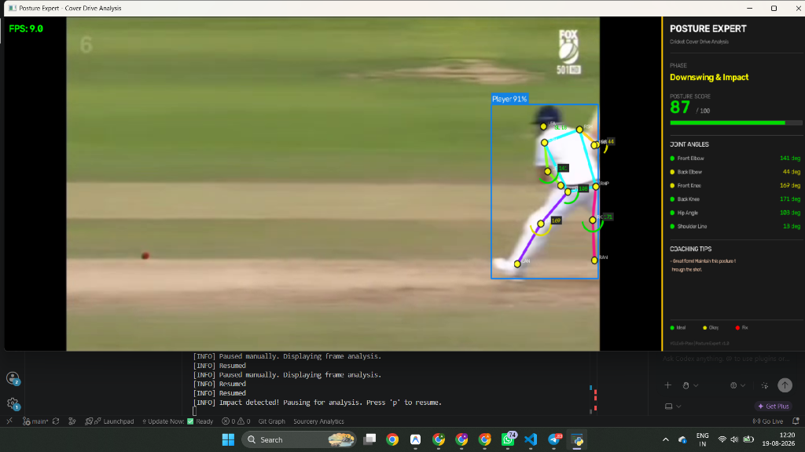
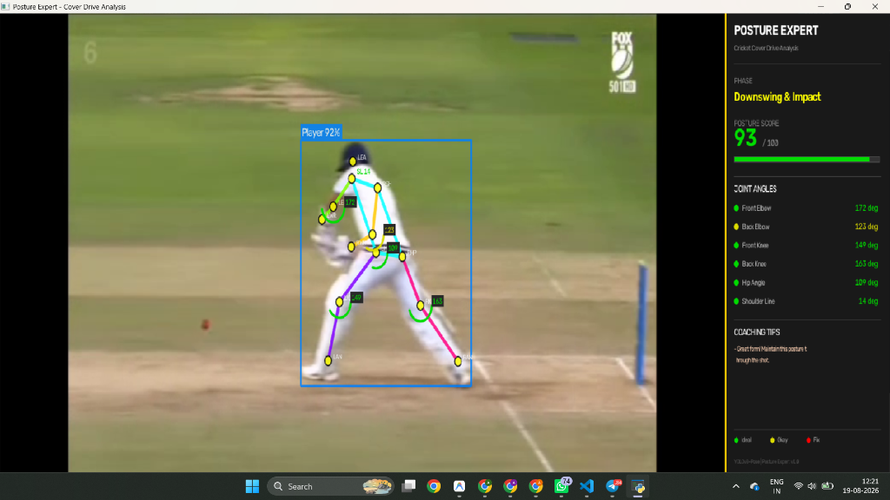
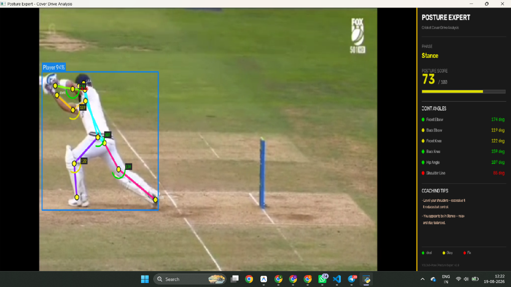
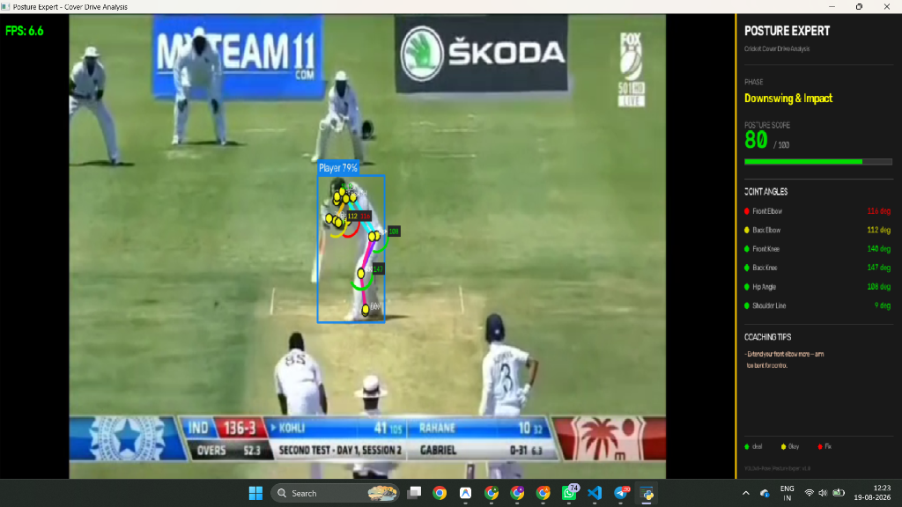
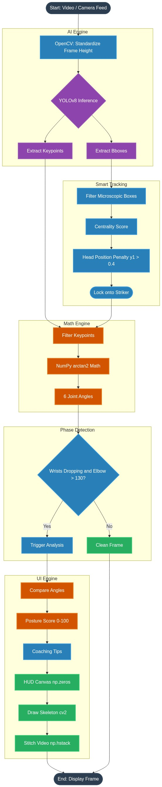

# Posture Expert: Cricket Cover Drive Analysis

A computer vision pipeline that analyses the cricket cover drive from broadcast-style video or images. It finds the batter, detects the phase of the shot, measures six joint angles at the moment of impact, and shows a posture score with coaching tips.

The pose model (YOLOv8-Pose) is pretrained by Ultralytics. My work in this project is everything around it: identifying the batter in a crowded scene, detecting shot phases when the legs are hidden by pads, computing the joint angles, scoring, and the on-screen display.

---

## Demo

| Impact phase (player 1) | Impact phase (player 2) |
| --- | --- |
| [](assets/demo1.png) | [](assets/demo2.png) |

| Stance phase | High-zoom tracking |
| --- | --- |
| [](assets/demo3.png) | [](assets/demo4.png) |

These are selected examples where the system works. See Limitations for where it does not. A further example is in [Demo 5](assets/demo5.png).

---

## What it does

- **Batter identification:** picks the batter out of a scene with bowlers, fielders, and the non-striker.
- **Phase detection:** labels the shot as Stance, Backswing and Stride, Downswing and Impact, or Follow-through.
- **Joint angles:** computes six angles (front and back elbow, front and back knee, hip rotation, shoulder alignment) from 17 body keypoints.
- **Posture score:** a 0 to 100 score based on how close the angles are to target ranges set in `config.py`. It is a heuristic, not a validated measure.
- **Coaching display:** shows the skeleton, angles, score, and short feedback on screen.
- **Freeze-frame:** plays the video cleanly, then pauses at the impact phase and draws the analysis, similar to a broadcast replay.

---

## Architecture

[](assets/flowchart.png)

The three problems this project works on:

1. **Multi-person scenes:** finding the batter among bowlers and fielders.
2. **Occlusion:** pads and gloves hide the lower-body keypoints.
3. **Speed:** keeping frame-by-frame analysis close to real time on a CPU.

### Design choices

**Pose model: YOLOv8-Pose.** I compared it with MediaPipe and OpenPose.

- MediaPipe is very fast but is built around a single person, and in cricket footage it tends to jump between the bowler, non-striker, and striker.
- OpenPose handles several people but is heavy, and needs a strong GPU to run in real time.
- YOLOv8-Pose detects people and 17 COCO keypoints in a single pass and runs on a CPU, which suited this project.

I lowered the detection confidence threshold to `0.35` to keep more keypoints when helmets, pads, and gloves reduce confidence. I did not measure the effect of this choice, and a lower threshold can also allow more false detections.

**OpenCV** is used for video reading, drawing, and the display. **NumPy** computes the joint angles with vectorised operations.

---

## Algorithms

### 1. Batter identification (`pose_detector.py`)

In broadcast footage the bowler can have the largest box, and the non-striker is often nearer the camera than the batter, so picking the biggest person fails. Instead, each detected person gets a score:

- **Centrality:** the camera usually follows the action, so the batter tends to be near the horizontal centre of the frame.
- **Depth penalty:** boxes whose feet touch the bottom 10% of the frame (typically a bowler in the foreground) are penalised.
- **Size filter:** very small boxes (distant fielders) are ignored.

This is a hand-tuned heuristic for broadcast-style footage. See Limitations.

### 2. Phase detection under occlusion (`cover_drive_analyzer.py`)

Pads often hide the knees and ankles, so the front-knee keypoint can have near-zero confidence. The phase logic therefore leans on the upper body. For the impact phase it looks for an extended front elbow (above 130 degrees) combined with the wrists dropping below the hips and shoulders.

### 3. Freeze-frame (`main.py`)

1. The video plays without overlays while the bowler runs in.
2. Frames are analysed in the background.
3. When the impact phase is detected, the video pauses, the keypoints are drawn, the six angles and the score are computed, and the coaching display appears.

---

## Benchmarks and evaluation

### Speed (CPU)

Measured on [CPU model and RAM], using `yolov8n-pose.pt` on [video resolution]:

| Stage | Time |
| --- | --- |
| YOLOv8 inference | 49.53 ms |
| OpenCV rendering | 0.64 ms |
| Angle calculation (NumPy) | 0.02 ms |
| Whole pipeline | about 18.86 FPS |

Inference is by far the largest cost. The angle calculation is negligible.

### Accuracy

`evaluation_metrics.py` contains functions for bounding-box IoU, temporal IoU of the impact phase, and PCK (percentage of correct keypoints). The example output in that file uses made-up numbers to show how each metric is calculated. **It is not a result.**

I evaluated the pipeline on [N] hand-labelled frames and clips from [source of footage]:

| Check | Result |
| --- | --- |
| Batter correctly identified | [x of N frames] |
| Impact phase, temporal IoU above 0.5 | [x of N clips] |
| PCK@0.2, elbows and knees | [value] on [N] annotated frames |

[One or two sentences on where it failed.]

---

## Limitations

- The batter-identification heuristic assumes broadcast-style footage, with the batter near the centre of the frame. It was tuned on [N] clips and will likely fail in other camera setups.
- Joint angles are measured in 2D, so they change with the camera angle.
- Pads and gloves reduce keypoint confidence, so lower-body angles are less reliable.
- Phase thresholds and the posture score's target ranges were set by hand and have not been validated against coaching data.
- Only one batter is analysed at a time. [State whether left-handed batters are supported.]
- This is a learning and demonstration project, not a replacement for a coach.

---

## Quick start

```bash
git clone https://github.com/paulamartya25/cover_drive.git
cd cover_drive
pip install -r requirements.txt
```

The pose model is downloaded automatically by Ultralytics on first run.

```bash
# Opens a file picker
python main.py

# Specific files
python main.py --video my_video.mp4
python main.py --image my_image.jpg
```

Controls:

| Key | Action |
| --- | --- |
| `p` | Pause and force an analysis of the current frame |
| `s` | Save a screenshot of the current analysis |
| `q` / ESC | Quit |

---

## Project structure

```
cover_drive/
├── main.py                  # Entry point and freeze-frame logic
├── pose_detector.py         # YOLOv8-Pose wrapper and batter identification
├── angle_calculator.py      # Joint angle computation
├── cover_drive_analyzer.py  # Phase detection and scoring
├── visualizer.py            # Skeleton drawing and on-screen display
├── config.py                # Constants and target angle ranges
├── evaluation_metrics.py    # IoU, temporal IoU, and PCK functions
├── assets/                  # Demo screenshots and flowchart
└── requirements.txt
```

---

## Future work

- Report real accuracy numbers on a labelled test set (see Accuracy above)
- Validate the posture score against coach-labelled clips
- Smooth angles over time to reduce jitter
- Support more shots (pull, cut, straight drive)

---

Built with [Ultralytics YOLOv8](https://docs.ultralytics.com/), OpenCV, and NumPy.

Author: Amartya Paul. [GitHub](https://github.com/paulamartya25)
